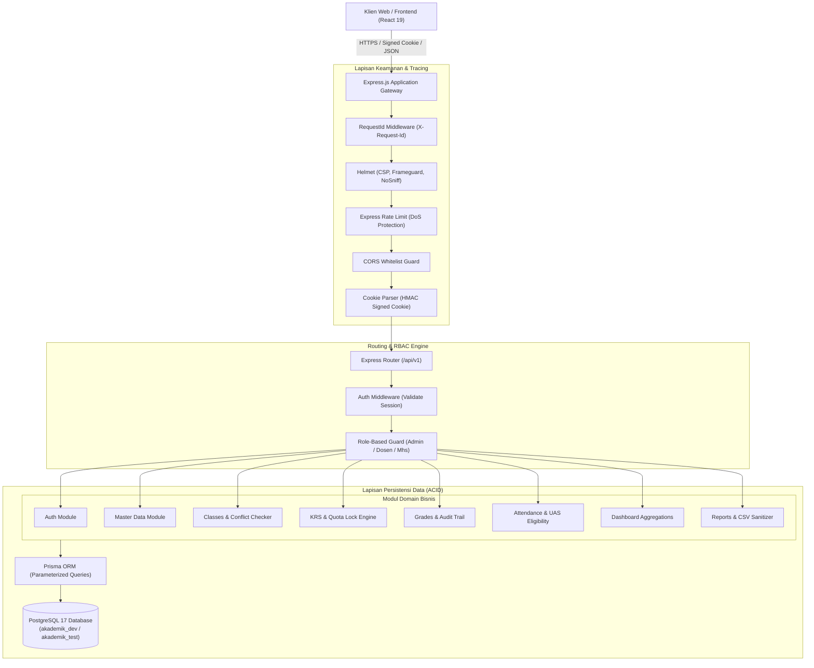
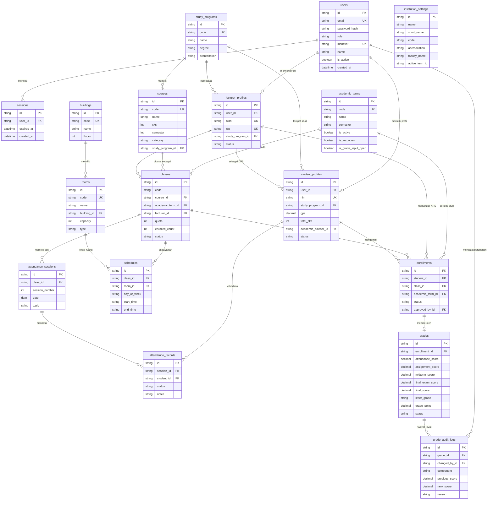

# Arsitektur Sistem Akademik Universitas Panda Raya (PANDAKAD)

Dokumen ini menjelaskan rancangan arsitektur, pola desain teknis, diagram relasi data (ERD), aturan bisnis akademik, dan postur keamanan dari backend REST API **PANDAKAD (Universitas Panda Raya - Fakultas Teknologi & Informatika)**.

---

## 1. Ikhtisar Sistem & Karakteristik Domain

Sistem Informasi Akademik UNPANDA dirancang untuk melayani kegiatan operasional perkuliahan **single-tenant** pada **Fakultas Teknologi dan Informatika (FTI)**. Tidak ada abstraksi multi-tenant kompleks (tidak ada tabel `faculties`), sehingga konfigurasi fakultas dan identitas kampus disimpan terpusat di tabel `institution_settings`.

### Aktor & Hak Akses (Role-Based Access Control)

1. **Admin (BAAK / Staf IT)**:
   - Pengelolaan data master kampus (program studi, kurikulum mata kuliah, gedung, ruangan perkuliahan).
   - Pengaturan periode akademik (buka/tutup jendela pengisian KRS dan masa input nilai).
   - Penjadwalan perkuliahan dengan deteksi otomatis bentrok ruangan dan bentrok dosen.
   - Akses dasbor eksekutif agregasi kampus dan unduh rekapitulasi data akademik.
2. **Dosen**:
   - Dosen Pengampu: Manajemen kelas diampu, pencatatan absensi mahasiswa (16 pertemuan), penginputan nilai berbobot (10% Presensi, 20% Tugas, 35% UTS, 35% UAS), dan finalisasi nilai.
   - Dosen Pembimbing Akademik (DPA): Tinjauan dan persetujuan/penolakan KRS mahasiswa bimbingan.
   - Ekspor rekap nilai dan matriks absensi kelas format CSV (RFC 4180).
3. **Mahasiswa**:
   - Pengisian rencana studi (KRS) online dengan penguncian kuota atomik database dan batas SKS dinamis berbasis IPS.
   - Jadwal kuliah harian dan informasi lokasi ruangan.
   - Kartu Hasil Studi (KHS) per semester dan Transkrip Nilai Kumulatif.
   - Monitoring presensi kuliah dan syarat kelayakan ujian akhir semester (UAS $\ge 75\%$).

---

## 2. Pola Arsitektur: Modular Monolith

Aplikasi menggunakan arsitektur **Modular Monolith** dalam satu codebase TypeScript terstruktur. Seluruh domain dibagi ke dalam modul-modul mandiri yang memiliki tanggung jawab tunggal (_Single Responsibility Principle_):

```
backend/
├── prisma/
│   ├── schema.prisma       # Definisi skema database PostgreSQL
│   ├── seed.ts             # Data seed realistis 35 pengguna kampus UNPANDA
│   └── migrations/         # Riwayat migrasi Prisma Migrate
├── src/
│   ├── config/             # Validasi variabel environment (Zod env parser)
│   ├── lib/                # Shared utilities (Prisma Client singleton, Pino logger)
│   ├── middlewares/        # Auth, RBAC, Error Handler, Rate Limiter, RequestId
│   ├── docs/               # Spesifikasi OpenAPI 3.1 & Swagger UI Route
│   ├── modules/
│   │   ├── auth/           # Login, Logout, Me, Session Management
│   │   ├── master/         # Prodi, Periode, Gedung, Ruangan, Matkul, Profil
│   │   ├── classes/        # Kelas Perkuliahan, Jadwal, Algoritma Cek Bentrok
│   │   ├── krs/            # Rencana Studi, Kuota Locking, DPA Approval
│   │   ├── grades/         # Pembobotan Nilai, KHS, Transkrip, Audit Log
│   │   ├── attendance/     # Presensi 16 Pertemuan, UAS Eligibility Check
│   │   ├── dashboard/      # Agregasi Statistik Admin, Dosen, Mahasiswa
│   │   └── reports/        # Ekspor CSV RFC 4180 & Sanitasi Formula Injection
│   ├── app.ts              # Express App Setup & Pipeline Middleware
│   └── server.ts           # HTTP Server Lifecycle & Graceful Shutdown
└── tests/                  # Integration & Unit Test Suite (Vitest + Supertest)
```

### Layered Architecture per Modul

Setiap modul menerapkan pemisahan 4 lapis yang ketat:
1. **Routes (`*.routes.ts`)**: Mendaftarkan HTTP endpoint, memasang guard autentikasi (`authenticate`), dan pembatasan peran (`requireRole`).
2. **Controller (`*.controller.ts`)**: Memvalidasi skema input (query, params, body) menggunakan Zod, memanggil service layer, dan memformat kode status HTTP (200, 201, dll.).
3. **Service (`*.service.ts`)**: **Pusat seluruh aturan bisnis** (validasi bentrok jadwal, kalkulasi IPK/IPS, locking kuota atomik, pengecekan IDOR, mitigasi formula injection). Controller dilarang memuat logika bisnis.
4. **Data Access (Prisma ORM)**: Mengakses tabel PostgreSQL menggunakan parameterized query atomik dan transaksi database (`prisma.$transaction`).

---

## 3. Diagram Alur Data & Komponen Arsitektur



---

## 4. Entity Relationship Diagram (ERD Mermaid)

Skema database relasional PostgreSQL 17 terdiri atas **14 tabel relasional** ternormalisasi:



---

## 5. Implementasi Aturan Akademik Inti

### A. Algoritma Deteksi Bentrok Jadwal Perkuliahan

Bentrok waktu terjadi jika hari kuliah sama dan interval waktu beririsan:
$$\text{isOverlap} = (\text{Start}_A < \text{End}_B) \land (\text{End}_A > \text{Start}_B)$$
Algoritma memeriksa dua dimensi:
1. **Bentrok Ruangan**: Ruangan yang sama tidak boleh digunakan oleh 2 kelas berbeda pada jam beririsan di hari yang sama.
2. **Bentrok Dosen**: Dosen yang sama tidak boleh dijadwalkan mengajar di 2 ruangan/kelas berbeda pada waktu yang bersamaan.

### B. Batas SKS Dinamis Berdasarkan IPS

Beban maksimal SKS mahasiswa pada semester berjalan ditentukan secara dinamis berdasarkan Indeks Prestasi Semester (IPS) semester sebelumnya:
- $\text{IPS} \ge 3.00 \implies \text{Maksimal } 24 \text{ SKS}$
- $2.50 \le \text{IPS} < 3.00 \implies \text{Maksimal } 21 \text{ SKS}$
- $2.00 \le \text{IPS} < 2.50 \implies \text{Maksimal } 18 \text{ SKS}$
- $\text{IPS} < 2.00 \implies \text{Maksimal } 15 \text{ SKS}$

### C. Pembobotan & Konversi Nilai Akademik

Nilai akhir mahasiswa dihitung dengan komposisi bobot baku FTI UNPANDA:
$$\text{Nilai Akhir} = (0.10 \times \text{Presensi}) + (0.20 \times \text{Tugas}) + (0.35 \times \text{UTS}) + (0.35 \times \text{UAS})$$

Konversi Nilai Angka ke Nilai Huruf dan Bobot Indeks:
| Rentang Nilai Akhir | Nilai Huruf | Bobot (Indeks) | Predikat           |
| ------------------- | :---------: | :------------: | ------------------ |
| $\ge 85.00$         |    **A**    |      4.00      | Sangat Baik        |
| $80.00 - 84.99$     |   **A-**    |      3.75      | Hampir Sangat Baik |
| $75.00 - 79.99$     |   **B+**    |      3.50      | Sangat Memuaskan   |
| $70.00 - 74.99$     |    **B**    |      3.00      | Memuaskan          |
| $65.00 - 69.99$     |   **B-**    |      2.75      | Cukup Memuaskan    |
| $60.00 - 64.99$     |   **C+**    |      2.50      | Cukup Baik         |
| $55.00 - 59.99$     |    **C**    |      2.00      | Cukup              |
| $40.00 - 54.99$     |    **D**    |      1.00      | Kurang             |
| $< 40.00$           |    **E**    |      0.00      | Tidak Lulus        |

### D. Perhitungan IPS, IPK, dan Aturan Mata Kuliah Ulang

- **Indeks Prestasi Semester (IPS)**:
  $$\text{IPS} = \frac{\sum (\text{SKS Matkul} \times \text{Bobot Nilai})}{\sum \text{SKS Semester}}$$
- **Indeks Prestasi Kumulatif (IPK)**:
  $$\text{IPK} = \frac{\sum (\text{SKS Matkul Lulus} \times \text{Bobot Nilai Tertinggi})}{\sum \text{SKS Kumulatif}}$$
- **Aturan Remedial / Mata Kuliah Ulang**:
  Jika mahasiswa mengambil mata kuliah yang sama lebih dari satu kali, transkrip kumulatif secara otomatis mengambil **nilai tertinggi** (_highest grade_), bukan nilai semester terakhir.

### E. Syarat Kelayakan Ujian Akhir Semester (UAS)

Mahasiswa diwajibkan menghadiri minimal **75%** dari total sesi perkuliahan tatap muka yang terlaksana (dari 16 sesi):
$$\text{Persentase Kehadiran} = \left(\frac{\text{Jumlah Hadir}}{\text{Sesi Terlaksana}}\right) \times 100\%$$
Jika persentase $< 75\%$, mahasiswa otomatis ditandai `TIDAK MEMENUHI SYARAT` dan tidak diizinkan mengikuti UAS.

---

## 6. Postur Keamanan & Hardening

1. **Hashing Kata Sandi**: Menggunakan algoritma mutakhir **Argon2id** (`argon2`), standar industri pengganti Bcrypt yang tahan terhadap serangan GPU cracking.
2. **Session Cookie**: Cookie sesi bertanda tangan (_HMAC signed cookie_) dengan flag `HttpOnly`, `SameSite: Lax`, dan `Secure` (di production), kebal terhadap pencurian token via serangan XSS.
3. **Pencegahan Insecure Direct Object Reference (IDOR)**:
   - Dosen hanya berhak mengubah nilai dan mengunduh laporan dari kelas yang dia ampu sendiri.
   - Mahasiswa hanya berhak melihat KHS, transkrip, dan presensi miliknya sendiri.
4. **Pencegahan Spreadsheet Formula Injection (CSV Injection)**:
   Seluruh nilai teks yang diawali dengan `=`, `+`, `-`, `@`, `\t`, atau `\r` otomatis diberikan prefix petik tunggal (`'`) sebelum diekspor ke CSV RFC 4180.
5. **Rate Limiting**:
   - `express-rate-limit` membatasi serangan brute-force login maksimal 15 percobaan per 15 menit per IP.
   - Batas global API 500 permintaan per 15 menit per IP.
6. **Pelacakan Tracing (Request ID)**:
   Setiap HTTP request diberikan header `X-Request-Id` (UUIDv4) untuk pelacakan end-to-end pada audit log.
7. **Pembersihan Database & Prepared Statements**:
   Prisma ORM mencegah 100% kerentanan SQL Injection melalui query terparameterisasi (_prepared statements_).
